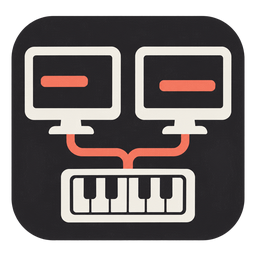
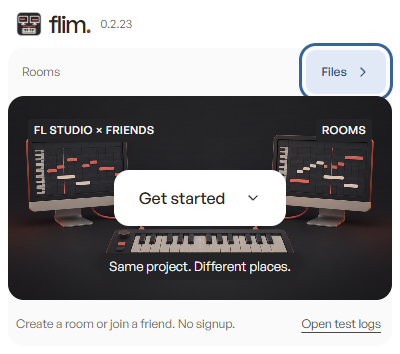
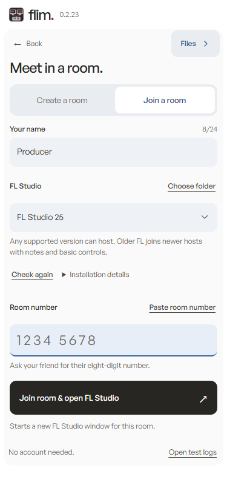
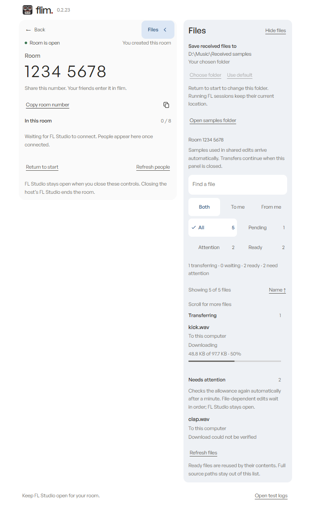

<h1 align="center">flim · Rooms</h1>

<strong>Make music together across FL Studio 24, 25 and 26.</strong> One small Windows app. An eight-digit room. No signup.

**FL Studio 24, 25 and 26 can share a room, with any supported version hosting.** This fork adds
a complete desktop app, mixed-version note sharing, automatic sample delivery and a Cloudflare
relay to [fckwader's original flim](https://github.com/fckwader/flim).

The current release was reviewed against **24.2.2.4597**, **25.2.5.5319** and **26.1.7.5654**.
FL24 is supported. Each installation still needs an exact verified build and engine fingerprint;
this is not a claim that every past, current or future patch works. When an older FL joins a
newer host, it shares **notes and basic controls** in a protected session workspace. Sounds and
features it cannot read stay unavailable. [See the compatibility table](BUILD-COMPATIBILITY.md).

  <a href="https://github.com/cashflowbeatz/flim/releases/tag/rooms-v0.2.23"><strong>Download Rooms for Windows</strong></a>
  · <a href="docs/QUICKSTART.md">Start your first room</a>
  · <a href="docs/FEATURES.md">Explore the features</a>
  · <a href="docs/TROUBLESHOOTING.md">Get help</a>

  
  

<em>Actual app interface with demonstration details. No account or separate client installation.</em>

## Start making music

Each person needs **Windows 10/11 x64**, their own supported FL Studio installation and the
complete **flim-rooms-0.2.23-win64.exe** from the release above. The portable executable opens
the app and extracts its bundled native client automatically. Participants need no Cloudflare
account, Node.js, VPN or separate server software.

1. Open Rooms and press **Get started**. Enter your name and select **FL Studio 24**, **25** or **26**.
2. Choose **Create a room**. Rooms starts a separate FL Studio window for the session.
3. Share **Copy room number** with a friend. They choose **Join a room**, enter that number and open FL.
4. Wait for FL's project synchronization to finish, then edit together. Record MIDI into the
   piano roll to share the resulting notes; each person hears their own installed sounds.

Want samples saved to another drive? Open **Files →**, then **Save received files to → Choose
folder** before entering a room. [First-room guide](docs/QUICKSTART.md).

## What you can do

| In your session | What flim handles |
| --- | --- |
| Draw, move, delete or record piano-roll notes | Note additions/deletions merge with a CRDT, including edits from members. Duplicate delivery does not duplicate the same note identity. |
| Turn supported controls and edit song structure | Shared parameters, channels, patterns, metadata, mixer state and compatible playlist data use ordered edits and temporary locks. Available fields depend on the receiving FL build. |
| Use different FL generations | Any supported host order is allowed. Older receivers use shared notes/basic controls when they cannot read the host's project. |
| Open a sound another person lacks | Missing or rejected plugins stay isolated; their shared state is retained while other supported editing continues. Matching installation changes trigger a bounded automatic retry. |
| Use the same VST from another folder/version | Stable VST2/VST3 IDs can resolve a locally scanned installation. The plugin must still accept the saved state; flim does not substitute by name alone. |
| Add a sample to a supported shared channel/playlist edit | Background workers transfer the referenced file, verify its size and SHA-256, save it locally and adapt the received path. Recoverable failures retain the waiting edit for retry. |
| Keep track of files | A lateral sidebar shows incoming/outgoing files, byte progress, search, status filters and recent activity. Choose a local destination per computer. |
| Recover from a problem | Local rotating diagnostics, status retry, settings recovery and bounded renderer recovery help explain failures without automatically closing FL Studio. |

[Read the feature guide](docs/FEATURES.md) for practical examples and limits.

## Files live beside your room

*Actual interface with simulated people and transfer activity; this demonstrates the controls,
not a live cross-computer test.*

Open **Files →** whenever you need it, then hide it to return to the compact room card. Ready
files are reused by content hash. Hidden status panels stop polling; native transfers continue
while FL stays open. No Syncthing process or whole sample-pack mirroring is required.

## What's new in 0.2.23

This publication includes the complete Rooms application and the accumulated compatibility,
relay, sample-sharing, UI and recovery work. The latest pass adds **39 further native fixes**.

- **More reliable shared editing:** complete control snapshots validate before applying; queued
  preset updates retain their originating FL version; malformed names and locks cannot target another item.
- **Less work while editing:** repeated waiting knob updates coalesce; native control batches yield
  after 64 writes or a 4 ms elapsed check; unchanged note merges avoid unnecessary allocations.
- **Clearer failure handling:** refused native note/clip insertions are detected, failed metadata
  changes are not marked synced, and optional plugin recovery waits when the queue is busy.
- **Better local plugin matching:** equivalent Windows paths match correctly; zero or ambiguous
  VST identities are rejected instead of guessed.

[Release notes](docs/releases/0.2.23.md) · [All 39 fixes and verification](client/desktop/QA-0.2.23.md)
· [Full change history](CHANGES.md)

## How thoroughly is it checked?

The 0.2.23 validation record includes **31 native harness executables**, **177 desktop backend
tests**, **127 room/UI checks**, **68 Files/UI checks** and **73 local Cloudflare tests**.
Native fixtures cover all nine host/member combinations of the three reviewed builds. Transfer
loopbacks, real Electron folder selection/window recovery, and portable packaging/startup were
also checked. Earlier live FL results are recorded separately in the versioned QA reports.

These results do not establish every FL patch or VST version. There was no fresh two-computer,
physical MIDI keyboard or live drag/drop session in the latest pass. See the
[test record and remaining coverage](docs/TESTING.md) before planning wider testing.

## Hosting and project safety

The current app connects to this fork's community relay. Its Cloudflare Worker and Durable
Object coordinate rooms; private R2 storage carries samples and large messages. There is no
15-minute application session cutoff or daily room-creation quota. Capacity, burst protection,
Cloudflare platform limits and R2 usage guards still apply. This is not unlimited free hosting.
[Run your own Cloudflare relay](server/cloudflare/README.md) or inspect the
[original Node.js workflow](LEGACY.md).

flim is unofficial and is not affiliated with Image-Line. It runs native code inside FL, so
save your work and begin with project copies. Original projects use separate session paths;
an older member's fallback requires a successful recovery save before preparing its workspace.
An actual invalid mutation/native fault can stop sharing while leaving FL open. TLS protects
traffic in transit; sessions are **not end-to-end encrypted**. Keep invitation numbers private.
No live audio streaming, newer-project conversion, missing-plugin installation, or encrypted
plugin-library sample synchronization is provided.

## For contributors

[Build from source](docs/BUILDING.md) · [Architecture and review map](docs/ARCHITECTURE.md)
· [Contribution guide](CONTRIBUTING.md) · [Report a bug](https://github.com/cashflowbeatz/flim/issues/new?template=bug_report.yml)

The original multiplayer engine and project are by [fckwader](https://github.com/fckwader/flim).
This fork preserves that history and adds the Rooms app and compatibility/reliability work.
[Credits and third-party notices](THIRD-PARTY-NOTICES.md) describe the artwork, fonts and dependencies.
This fork does not add or change the upstream project's license.
