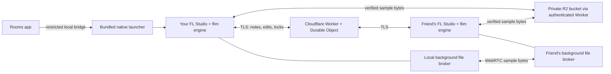

# Architecture and upstream review map

This is an extension of [fckwader/flim](https://github.com/fckwader/flim). The native engine
remains responsible for FL interaction; the desktop app is a room/setup surface, not another DAW.

## Review by responsibility

| Area | Files to start with | Review focus |
| --- | --- | --- |
| Exact FL support | `client/launcher/flim.c`, `client/common/flim_profile.h`, `client/profiles/`, `k_flBuilds` in the engine | Exact identity/fingerprint gates, FL24 adapters, reviewed mappings. |
| Native editing | `client/engine/flim_engine.c`, `client/common/flim_json.h` | Native setter validation, loading barriers, generation guards, bounded ordered queues, retained plugin state. |
| Recorded notes | `client/common/flim_notes_crdt.h`, `server/cloudflare/NOTES-CRDT.md` | Stable IDs, tombstones, immutable-note conflicts, local-unsent merge, bounded history. |
| Plugin adaptation | `client/common/flim_plugin.h`, native plugin harnesses | Stable VST identity/path matching, source-version provenance, opaque state preservation. |
| Files | `client/common/flim_files.h`, `flim_cloud.h`, desktop `file-transfers.cjs`/`sample-location.cjs` | Hash/size verification, cache paths, ordered pending edits, cancellation/retry, local status reads. |
| Direct samples | desktop `peer-core.cjs`, `peer-electron.cjs`, `peer-worker.js`; Worker `/peer/` route | Scoped native capabilities, loopback authentication, sandboxed WebRTC, bounded streaming and native verification/fallback. See [direct files](PEER-FILES.md). |
| Desktop process | `client/desktop/electron/` | Allowlisted IPC, credentials kept in main/native processes, atomic settings, scoped launches, diagnostics/recovery. |
| Desktop UI | `client/desktop/src/` | Compact room card, accessible installation picker, Files sidebar, input/focus/status behavior. |
| Cloudflare relay | `server/cloudflare/src/` | Room admission, authentication, sequencing/locks, hibernation lifecycle, R2 budgets/cleanup, request bounds. |
| Original server | `server/src/`, `server/test/` | Retained Node.js route and earlier authority, lock, sample-lifecycle/config fixes. |

## Boundaries worth keeping

- Each FL process owns its windows and audio. flim sends supported state/edits and referenced
  files, not a desktop video or live audio stream.
- Only note additions/deletions use the CRDT. Projects, plugin states and structural mutations
  use sequence/lock rules; they are not arbitrary offline-mergeable objects.
- Older members can use the portable workspace rather than loading newer opaque data. A
  successful recovery save is required before workspace preparation.
- Missing/rejected plugins keep shared bytes and block their own unsafe parameter writes;
  unrelated supported editing continues. Actual native faults can stop sharing.
- The relay is trusted with room/file data. TLS is not end-to-end encryption. R2 is private and
  accessed through authenticated Worker routes, with account-wide application budgets.
- The public app defaults to this fork's relay. Upstream maintainers should choose their own
  endpoint/deployment policy before distributing an upstream build. No Cloudflare auth state,
  hosting keys, Image-Line binaries or proprietary presets are part of this contribution.

The PR is organized into native, relay, desktop and documentation commits so maintainers can
review those areas separately. [Build](BUILDING.md), [test](TESTING.md) and
[compatibility](../BUILD-COMPATIBILITY.md) guides describe the evidence and remaining work.
