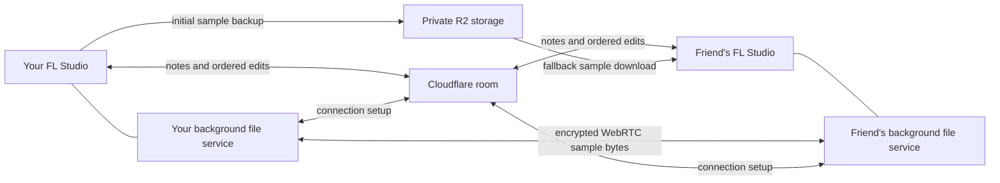

# Direct sample transfers

Rooms 0.2.25 can send a referenced sample directly between participants using a WebRTC data
channel. Cloudflare authenticates the participants and exchanges connection setup messages.
It continues to order edits and manage locks. Recorded notes keep their existing CRDT merge.

## What happens when you add a sample

1. The native engine finds a file referenced by a supported shared edit and calculates its
   content hash. The app registers that file with its local background service.
2. The existing R2 upload completes before the sample-dependent edit is sent. A late joiner
   or a person who cannot establish a direct connection therefore has a backup available.
3. The receiver tries a connected participant for those exact bytes. Requests contain a
   hash and byte count, not a request to browse another person's folders.
4. The native receiver checks the full byte count and SHA-256 before accepting the file.
   An unavailable, changed, corrupt or interrupted direct transfer falls back to R2. The
   waiting musical edit uses the existing retry and path-rewrite flow.

Choose the destination in **Files > Save received files to > Choose folder** before opening
FL for the room. Direct and R2 downloads use that same destination and cache.

## Requirements and limits

- Both sides need the 0.2.25 app and its bundled engine for a direct transfer. Earlier clients
  keep using R2 and can remain in the same room. No Node.js service, VPN, Syncthing or separate
  client installation is needed on a friend's computer.
- Close the app's controls to hide them while a launched FL session is running. The background
  file service stays available. Open the app again to show the controls. It exits when its last
  launched FL process ends and the controls are hidden.
- Restrictive networks can prevent direct connections. Cloudflare STUN assists discovery;
  this release has no TURN service. R2 supplies the fallback without a confirmation prompt.
- Direct downloads reduce R2 reads. They do **not** eliminate initial uploads, R2 storage,
  room traffic, platform limits or the configured R2 usage guards. R2 budgets still apply to
  R2 operations. A direct download of an already available sample can work during an R2 pause.
- Each launch has two incoming and two outgoing direct transfer slots, 32 KiB chunks and a
  bounded send window. A full direct-transfer slot falls back to R2. Each file is limited to
  the existing 90,000,000-byte sample ceiling.
- This transfers referenced sample files. Full project snapshots, large edit messages and
  plugin state keep their existing Cloudflare/R2 paths. It is not full-folder replication,
  live audio streaming or plugin installation.
- WebRTC encrypts its file data channel. Room edits and R2 backups still trust the relay, so
  the complete session is not end-to-end encrypted. Direct participants can learn each
  other's network addresses, as with ordinary peer connections.

## Implementation boundaries

The app starts an authenticated HTTP broker on `127.0.0.1` with a random token for each native
launch. The token is passed only to that FL process. Browser-origin requests are rejected.
The main process owns file paths and reads only locally registered sources. A hidden sandboxed
renderer owns WebRTC and has no Node.js, filesystem, camera or microphone access. Its IPC is
restricted to its own frame.

The native welcome supplies a separate file capability, valid only while that native participant
is connected. The companion authenticates at `/peer/<room>`; it does not count as another person
or acquire edit locks. The Worker only forwards bounded offer/answer/ICE messages within that
room. Reconnecting the native session replaces its capability and clears old transfers. Leaving
revokes its companion; the host leaving still ends the room.

## Evidence

`npm run test:peer` runs actual Electron WebRTC channels against a local Cloudflare emulator.
It compares a 2,097,171-byte file, checks two simultaneous downloads, changed sources, lost peers,
local authentication, stale generations and one deliberate R2 fallback. Three direct downloads
cause no R2 reads; the deliberate fallback causes one. The test uses two isolated launch
sessions in one test app, not two physical computers or a remote NAT test.

Native WinHTTP loopbacks separately check registration, SHA-256 acceptance, corrupt/missing peer
fallback, restored progress and direct access during an R2 retry pause. Broker tests cover
concurrency, cleanup, session replacement and malformed input. See [testing](TESTING.md) and
[0.2.25 QA](../client/desktop/QA-0.2.25.md) for results and remaining coverage.
